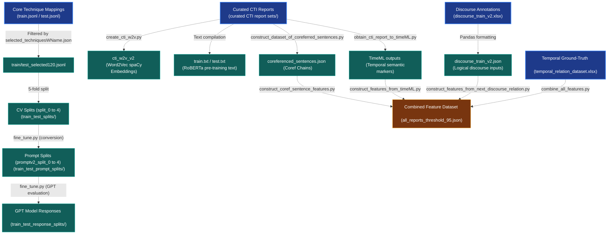

# ChronoCTI — Dataset Flow & Lineage

This document explains the lifecycle, lineage, and transformation of all datasets used in the **ChronoCTI** project, visualizing how raw files in the root are processed into model inputs and outputs.

---

## 1. Dotted Flowchart (Mermaid)



---

## 2. Dotted ASCII Diagram

```
[Parent Raw CTI Reports]
        :
        + . . . (create_cti_w2v.py) . . . . . . . . . . . . . . . > [cti_w2v_v2 (spaCy Embeddings)]
        :
        + . . . (Compiled raw text) . . . . . . . . . . . . . . . > [train.txt / test.txt]
        :
        + . . . (construct_dataset_of_coreferred_sentences.py) . . > [coreferenced_sentences.json]
        :
        + . . . (obtain_cti_report_to_timeML.py) . . . . . . . . . > [TimeML XML / JSON]

[Parent Core Technique Mappings (train.jsonl)]
        :
        : (Filtered for 120 target TTPs)
        v
[train_selected120.jsonl]
        :
        : (5-fold bagging split)
        v
[CV Splits (splits 0-4)]
        :
        + . . . (fine_tune.py conversion) . . . . . . . . . . . . > [Prompt Splits (splits 0-4)]
        :                                                                   :
        :                                                                   : (GPT fine-tuning)
        :                                                                   v
        + . . . (fine_tune.py evaluation) . . . . . . . . . . . . > [GPT Model Responses (splits 0-4)]

[Parent Discourse Relations (discourse_train_v2.xlsx)]
        :
        : (Pandas extraction)
        v
[discourse_train_v2.json]
        :
        : (Discourse relation extraction)
        v
[Discourse Features] . . . . . . . . . . . . . . . . . . . . . . . . . . +
                                                                         :
[Parent Temporal Ground-Truth (temporal_relation_dataset.xlsx)]          :
        :                                                                :
        : (combine_all_features.py)                                      v
        + . . . . . . . . . . . . . . . . . . . . . . . . . . . . > [Combined Feature Dataset]
                                                                    (all_reports_threshold_95.json)
```

---

## 3. Step-by-Step Dataset Explanations

### Step 1: Word Embeddings & Language Model Adaption
* **Source:** [curated CTI report sets/](file:///Users/mahshinislam/ChronoCTI%20Resource/ChronoCTI-main/Datasets/Dataset/CTI%20Reports/curated%20CTI%20report%20sets) (Raw Intrusion Narratives).
* **Derivation:** Sentences are tokenized, bigrams are extracted, and custom Word2Vec vectors are trained. Separately, raw text blocks are compiled into MLM text files.
* **Outputs:** 
  * `cti_w2v_v2`: Custom word vectors that downstream classifiers use to match terminology.
  * `train.txt` / `test.txt`: Raw text used to domain-adapt RoBERTa into **RoBERTa-CTI**.

### Step 2: Sentence-to-Technique Multilabel Datasets
* **Source:** `train.jsonl` / `test.jsonl` (All techniques mapped to sentences).
* **Derivation:** Mappings are filtered down to 120 selected techniques (`train_selected120.jsonl`). The dataset is then divided into 5 bagging splits.
* **Outputs:** 
  * `train_test_splits/`: 5-fold cross-validation datasets used to train spaCy classifiers.
  * `train_test_prompt_splits/`: Format conversion mapping user sentences and target techniques to message prompts.
  * `train_test_response_splits/`: Log files capturing the actual outputs vs predictions from the fine-tuned OpenAI GPT models.

### Step 3: Discourse & Coreference Extraction
* **Source:** [discourse_train_v2.xlsx](file:///Users/mahshinislam/ChronoCTI%20Resource/ChronoCTI-main/Datasets/Dataset/discourse_train_v2.xlsx) & [curated CTI report sets/](file:///Users/mahshinislam/ChronoCTI%20Resource/ChronoCTI-main/Datasets/Dataset/CTI%20Reports/curated%20CTI%20report%20sets).
* **Derivation:** Discourse relationships between consecutive/coreferenced sentences are converted to JSON. Coreference resolution computes which non-adjacent sentences talk about the same malware/entity.
* **Outputs:** 
  * `discourse_train_v2.json`: Labeled logical sentence connections.
  * `coreferenced_sentences.json`: Sentence sequences referencing identical variables.

### Step 4: Temporal Extraction & Target Merging
* **Source:** [TimeML XML outputs](file:///Users/mahshinislam/ChronoCTI%20Resource/ChronoCTI-main/TimeML/unseen_reports_timeML_outputs) & [temporal_relation_dataset.xlsx](file:///Users/mahshinislam/ChronoCTI%20Resource/ChronoCTI-main/Datasets/Dataset/temporal_relation_dataset.xlsx) (Ground Truth).
* **Derivation:** TimeML rules extract explicit timestamps/sequences. All signals (embeddings, discourse, coref, TimeML) are combined per technique pair and matched with target labels.
* **Outputs:**
  * `all_reports_threshold_95.json` (Combined Features): The final tabular dataset fed directly into XGBoost and Graph Neural Networks (DGL) to predict final attack-flow timelines.
