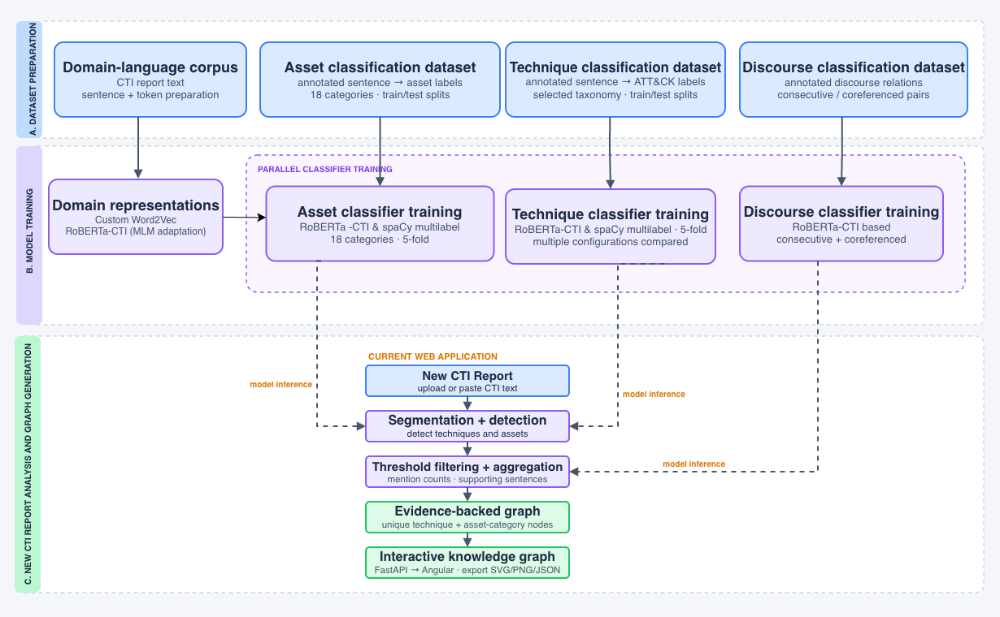

# ChronoCTI

**Turn cyber threat reports into structured information about attack techniques, affected asset categories, and relationships between attack activities.**

Cybersecurity reports usually describe an intrusion in paragraphs. ChronoCTI uses natural language processing (NLP) and machine learning (ML) to help readers identify the activities in those paragraphs, find the sentences that support them, and explore their relationships in a graph.

The repository contains a **research pipeline for learning temporal relationships** and an **interactive web application for exploring individual reports**.

> **Code-only release:** Source code, configuration, documentation, and small label mappings are included. Datasets, trained models, intermediate results, and installed dependencies are excluded. The web application can use keyword rules when trained classifiers are unavailable; reproducing the research experiments requires the external data and models.

## Contents

- [What does ChronoCTI do?](#what-does-chronocti-do)
- [Architecture](#architecture)
- [How the web application works](#how-the-web-application-works)
- [How the research pipeline works](#how-the-research-pipeline-works)
- [Repository structure](#repository-structure)
- [Run the web application](#run-the-web-application)
- [Run the research workflow](#run-the-research-workflow)
- [Outputs and interpretation](#outputs-and-interpretation)
- [Documentation and license](#documentation-and-license)

## What does ChronoCTI do?

ChronoCTI connects the language of a report to structured cybersecurity concepts:

| Term | Meaning in this project |
|---|---|
| CTI | Cyber Threat Intelligence: information describing threats, attackers, and their activities. |
| TTPs | Tactics, techniques, and procedures: attacker objectives, methods, and specific actions. The classifiers here primarily identify technique labels. |
| ATT&CK technique | A standardized label for an attacker behavior, such as command execution or credential dumping. |
| Asset category | A type of system mentioned in a report, such as a workstation, server, router, or industrial controller. The project defines 18 categories. |
| Discourse relation | How two sentences relate to each other, for example elaborating on an event or describing a next step. |
| Coreference | Different expressions that refer to the same entity, such as “the malware” and “it.” |
| Temporal relation | How two activities relate in time, such as one occurring next or overlapping with another. |

For example, a report might say:

> The attacker ran PowerShell on a workstation. Later, the attacker used RDP to access a server.

ChronoCTI can identify technique and asset mentions and preserve the supporting sentences. The web application presents these findings interactively. The research pipeline adds further linguistic and statistical evidence to learn relationships between techniques.

## Architecture



The supplied architecture diagram groups the project into three parts:

1. **Dataset preparation:** Prepare domain text and annotated examples for asset, technique, and discourse classification.
2. **Model training:** Build CTI-specific language representations and train classifiers for the different tasks.
3. **Report analysis and graph generation:** Process a new report, filter detections, group repeated mentions, and display a graph with supporting evidence.

**Implementation note:** The diagram shows a discourse-classifier connection to the web application. In the current backend, report analysis loads asset and technique classifiers when available and supplements them with keyword rules. Discourse classifiers, TimeML features, and GNN/XGBoost temporal predictions belong to the offline research workflow and are not connected to the current web endpoint. The asset training code also supports several representations; the single-model asset script currently uses spaCy's large English vectors.

## How the web application works

1. **Provide a report.** Paste text, import a `.txt` or `.md` file, or try the example in the interface.
2. **Split the text into sentences.** Each sentence becomes a unit of evidence for later detections.
3. **Detect techniques and assets.** Available trained models and built-in keyword rules identify relevant labels.
4. **Apply thresholds.** Detections below the selected technique or asset threshold are removed.
5. **Combine repeated mentions.** Each technique or asset category gets one graph node, with its mention count and supporting sentences retained.
6. **Build relationships.** The backend links techniques and assets mentioned in the same sentence and records the sequence of technique mentions across sentences.
7. **Explore and export.** Inspect evidence, search, filter, pan, zoom, and export the graph as SVG, PNG, or JSON.

The interface uses Angular, the API uses FastAPI, and the graph construction uses NetworkX.

## How the research pipeline works

The following procedure summarizes [PROJECT_FLOW.md](PROJECT_FLOW.md), with the asset-classification branch from the architecture diagram included. Several feature branches can run independently once their inputs are ready; their outputs must be available before the final combination step.

### 1. Prepare the datasets

Collect CTI text and prepare the annotations required for each task:

- **Domain-language corpus:** Sentences used to learn cybersecurity vocabulary.
- **Technique dataset:** Sentences annotated with selected ATT&CK techniques.
- **Asset dataset:** Sentences annotated with one or more of the 18 asset categories.
- **Discourse datasets:** Labeled pairs of consecutive or coreferenced sentences.
- **Temporal-relation dataset:** Labeled technique pairs used to train and evaluate the final relation models.

The [dataset flow guide](DATASET_FLOW.md) describes data organization. These datasets are not distributed in this code-only repository.

### 2. Learn domain-specific language representations

`create_cti_w2v.py` trains Word2Vec embeddings on CTI sentences and converts them into spaCy vectors. `roberta_cti_and_discourse_classifier/mlm.py` adapts RoBERTa to CTI text through masked language modeling: learning to recover hidden words from their context.

The resulting representations help downstream classifiers interpret cybersecurity language.

### 3. Train the sentence classifiers

The technique and asset classifier directories contain spaCy training configurations for custom Word2Vec, large English vectors, transformer representations, base RoBERTa, and CTI-adapted RoBERTa. Their experiment scripts compare configurations across five data splits.

A sentence can receive multiple labels. For example, one sentence may describe more than one technique or mention several asset categories. Separate discourse classifiers learn relationships between consecutive and coreferenced sentence pairs.

### 4. Extract techniques and supporting linguistic evidence

Apply the technique classifiers to report sentences, then construct complementary evidence:

| Evidence | What it contributes | Main location |
|---|---|---|
| Coreference | Connects sentences referring to the same entity, including non-adjacent sentences. | `Neuralcoref/` |
| TimeML | Extracts events, time expressions, and temporal relationships. | `TimeML/` |
| Sentence context | Measures proximity, shared sentences, and sentence similarity. | `temporal-learner-code/` |
| Discourse | Adds predictions about the relationship between sentence pairs. | `roberta_cti_and_discourse_classifier/`, `temporal-learner-code/` |
| Temporal wording | Counts cues such as “then,” “before,” and “meanwhile.” | `temporal-learner-code/` |
| Association rules | Measures how often techniques occur together in the background corpus. | `apriori-features/` |

Association-rule features provide background statistical evidence. Their construction should finish before the final feature combination, even though the project flow document describes that branch after feature engineering.

### 5. Combine features for each technique pair

The feature scripts build one example for an ordered pair of techniques in a report. Each example combines classifier confidence, sentence context, discourse predictions, TimeML signals, temporal wording, and association statistics.

`combine_all_features.py` and related scripts assemble these inputs for the temporal learners.

### 6. Train and evaluate temporal-relation models

The offline workflow includes graph neural networks, XGBoost, and other classifier comparisons. It learns the following relation labels:

| Label | Intended meaning |
|---|---|
| `NEXT` | One technique precedes the other. |
| `OVERLAP` | The activities overlap in time. |
| `CONCURRENT` | The activities occur at the same time. |
| `NULL` | No temporal relation is assigned. |

Evaluation scripts assess predictions using measures such as precision, recall, F1, and ranking metrics. The workflow also includes graph generation and graph-level evaluation. Outputs depend on the selected experiment and supplied data; this README does not claim a measured accuracy score.

## Repository structure

| Path | Purpose |
|---|---|
| `create_cti_w2v.py` | Train domain-specific word embeddings. |
| `roberta_cti_and_discourse_classifier/` | Adapt RoBERTa and train discourse classifiers. |
| `sentence_to_technique_classifier/` | Train and evaluate sentence-to-technique classifiers. |
| `sentence_to_asset_classifier/` | Train and evaluate sentence-to-asset classifiers. |
| `Neuralcoref/` | Construct coreference-based sentence relationships. |
| `TimeML/` | Temporal annotation tools and feature extraction. |
| `apriori-features/` | Association-rule feature construction. |
| `temporal-learner-code/` | Feature combination, relation learning, and evaluation. |
| `web-server/backend/` | FastAPI endpoints and evidence-based graph construction. |
| `web-server/frontend/` | Angular report explorer. |
| `docs/images/` | Architecture illustration used in this README. |
| `zenodo-release/` | Release preparation script and metadata. |

## Run the web application

The commands below are for a macOS/Linux shell. Use Python 3.11, as specified by the project's Pipfiles, and Node.js/npm compatible with the Angular 18 frontend. The web dependencies below cover the basic keyword-based application; trained pipelines can require additional packages matching their training environment.

### 1. Clone and prepare Python

```sh
git clone https://github.com/mahshin1428/ChronoCTI.git
cd ChronoCTI
python3.11 -m venv .venv
source .venv/bin/activate
python -m pip install fastapi uvicorn python-multipart networkx spacy
```

If you already have this project locally, open its root directory and prepare or activate your Python environment there.

### 2. Place the asset labels where the backend expects them

The backend currently reads asset labels from a path inside the excluded dataset directory. For a fresh code-only checkout, copy the included small label mapping into that location:

```sh
mkdir -p Datasets/Dataset/Sentence-to-asset-mappings
cp sentence_to_asset_classifier/assetsWName.json \
  Datasets/Dataset/Sentence-to-asset-mappings/selected_assetsWName.json
```

This copies category names only. It does not supply a training dataset. Without it, asset detections can display IDs instead of readable names.

### 3. Build the frontend

```sh
cd web-server/frontend
npm ci
npm run build
cd ../..
```

The build creates `web-server/static/browser/`, which is intentionally excluded from Git.

### 4. Start the application

```sh
python web-server/run.py
```

Open **http://localhost:8000**. Interactive API documentation is available at **http://localhost:8000/docs**.

Without trained models, the backend uses keyword detection and falls back to a basic English sentence splitter if no supported spaCy English model is installed. This mode is useful for exploring the interface; it does not reproduce classifier evaluation results.

### Optional: enable trained classifier inference

Provide compatible spaCy pipelines at the locations currently configured in `web-server/backend/pipeline.py`:

| Classifier | Expected directory |
|---|---|
| Asset | `sentence_to_asset_classifier/bagging_models/asset_classifier_model/model-best/` |
| Asset fallback | `sentence_to_asset_classifier/bagging_models/lgAll-0/model-best/` |
| Technique | `sentence_to_technique_classifier/bagging_models/robertaCtiAll-final/model-best/` |

Install the packages required by those pipelines, including transformer support where applicable. Check startup messages to confirm loading: the backend can continue using rules if a classifier fails to load.

See [the web application guide](web-server/README.md) for development commands, API fields, and checks. Its references to an existing `venv/` and prebuilt static files describe the local development setup; a fresh clone needs the preparation above.

## Run the research workflow

The research code is organized as individual scripts with component-specific environments and local input paths. There is no single command that recreates all experiments from a fresh code-only clone.

1. **Supply the data.** Restore the corpora, annotations, train/test splits, and ground-truth relation labels described in [DATASET_FLOW.md](DATASET_FLOW.md).
2. **Prepare component environments.** Use the relevant `Pipfile`, lockfile, requirements, and configuration files. The root Pipfile covers embedding preparation, not the entire project. Review script imports and external tools for each stage.
3. **Build representations.** Run `create_cti_w2v.py` from the repository root and `mlm.py` from its component directory. Align the output checkpoint locations with the downstream configurations.
4. **Train classifiers.** Train the asset, technique, and discourse models using their prepared inputs. The classifier directories also provide `train_single_model.py` scripts for the model locations used by the web app.
5. **Process reports.** Generate sentence-level technique predictions and the consecutive/coreferenced sentence-pair predictions needed by the feature scripts.
6. **Construct feature branches.** Run coreference, TimeML, sentence, discourse, temporal-cue, and association-rule extraction.
7. **Combine and learn.** Assemble feature files, then run the selected temporal training and evaluation scripts in `temporal-learner-code/`.
8. **Inspect results.** Review evaluation outputs, supporting evidence, and generated report graphs.

Before running training, check these implementation details:

- Many scripts resolve paths relative to their working directory. Run each script from the directory its input paths expect.
- Checkpoint names vary across scripts, including `CTI-Roberta` and `Roberta-CTI`; match the actual configuration paths.
- The technique project's `project.yml` selects GPU ID `0`. Adjust device settings for your environment; CPU runs use `-1` in that spaCy setting.
- `sentence_to_technique_classifier/train_models.py` saves metrics and then deletes experiment model directories through `purge()`. Review that behavior before using it when you need to retain trained weights. The single-model script does not call that cleanup routine.
- Some historical `STEPS.md` references have outdated names. Use the scripts present in this checkout and the detailed [project flow](PROJECT_FLOW.md) to resolve them.
- OpenAI-based comparison scripts are optional and separate from the web app's local inference. Scripts requiring credentials should use environment variables; keep secrets outside Git.

## Outputs and interpretation

| Workflow | Main outputs | How to read them |
|---|---|---|
| Web application | Interactive graph; SVG/PNG images; JSON with evidence and detection sources. | Explore what the report mentions and which sentences support the links. |
| Offline research | Feature files, trained checkpoints, evaluation results, and per-report `.gexf` graphs. | Examine learned temporal relationships and their evaluation against labeled data. |

For the web graph:

- **Technique nodes** represent unique ATT&CK labels.
- **Asset nodes** represent categories, not individually identified machines.
- **Co-mentioned links** mean a technique and asset appeared in the same sentence. They do not confirm that the technique targeted that asset.
- **Next-mention links** follow the narrative sequence. They do not establish execution order or causality, and repeated techniques can form cycles.
- **Keyword scores** are fixed rule scores rather than calibrated probabilities. Inspect detection provenance and the supporting text when interpreting results.

Datasets, checkpoints, large generated files, and local credentials remain excluded by [`.gitignore`](.gitignore). They must be supplied or regenerated separately to reproduce the complete workflow.

## Documentation and license

- [Project flow and detailed research stages](PROJECT_FLOW.md)
- [Dataset organization and flow](DATASET_FLOW.md)
- [Web application and API guide](web-server/README.md)
- [Code-only GitHub upload guide](GITHUB_UPLOAD.md)
- [Extended project description](PROJECT_DESCRIPTION.md)

The repository includes the [Apache License 2.0](LICENSE). Bundled third-party components retain their own notices and license terms; see their directories, including [TimeML](TimeML/LICENSE).
